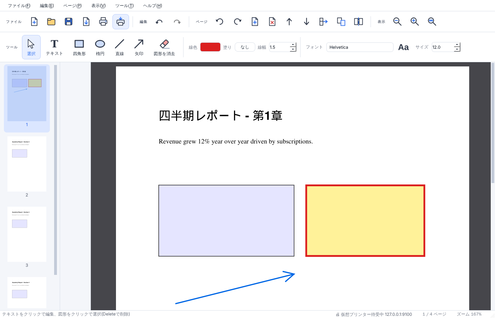

# Leafwright — 軽量クロスプラットフォーム PDF エディタ

GUI で直感的に操作できる、Python 製の軽量 PDF エディタです。
Windows / macOS / Linux で同じコードがそのまま動きます。



## 機能

| 要件 | 実装 |
|---|---|
| GUI で簡単操作 | Qt (PySide6) 製。左にページサムネイル、中央にページビュー。ツールバーから選択/テキスト/四角形/楕円/直線/矢印/図形消去を切替 |
| PDF の読み取り・書き出し | PyMuPDF で読み込み・描画。画像 (PNG/JPEG/TIFF/SVG)・XPS・EPUB も PDF として開ける |
| 簡単な文章の編集 | テキストをクリック → ダイアログで文字列・フォント・サイズ・色を変更/削除。元の位置(ベースライン)に書き戻す。任意の位置に新規テキスト追加も可能 |
| 図形の挿入・削除 | 四角形・楕円・直線・矢印を注釈として追加(線色・塗り・線幅指定)。クリックで選択、ドラッグで移動、Delete で削除。PDF 内に元から埋め込まれたベクター図形も「図形を消去」ツールで削除 |
| 墨塗り | 範囲内の文字・画像ピクセル・範囲に収まるベクター図形・注釈・代替テキストを PDF から**完全に削除**して黒で塗る(上から黒い四角を重ねるだけではない)。範囲の外は一切変えない。範囲の縁をまたぐ図形(背景・罫線など)はそのまま残して黒い箱の下に隠し、黒い箱とともに選択・移動・削除できなくする。保存前なら Ctrl+Z で戻せる |
| PDF の統合 | 「PDF を結合」で複数ファイルを任意位置に挿入 |
| ページの抽出 | 範囲指定 (`1-3,5,8-`) で別ファイルへ抽出 |
| ページの編集 | 回転・削除・空白ページ挿入(A4/A3/A5/B4/B5/Letter/Legal)・前後移動・サムネイルのドラッグ&ドロップで並べ替え |
| ページの分割 | N ページごと、または範囲指定で複数ファイルに分割 |
| 国際規格に合わせた保存 | PDF 1.4〜2.0 のバージョン指定、PDF/A-1b・2b・2u・3b (ISO 19005)、PDF/X-3 (ISO 15930-6)。Ghostscript があれば本変換、無ければベストエフォート(後述)。リニアライズ(Web 最適化)対応 |
| さまざまなフォント | OS にインストール済みの TTF/OTF/TTC を自動検出して埋め込み。足りない文字(日本語など)は CJK フォールバックで自動補完。任意のフォントファイルの追加も可能 |
| 軽量 | 依存は PyMuPDF・pikepdf・PySide6-Essentials の 3 つのみ。Electron 等のブラウザランタイム不要 |
| 共通言語 | 100% Python。ネイティブ処理は MuPDF / QPDF / Qt (いずれも 3 OS 対応) |
| 印刷 | OS の印刷ダイアログから任意のプリンターに出力(ページ範囲・部数指定可)。ページごとに向きを自動調整 |
| 他アプリからの「印刷→Leafwright」 | 「Leafwright PDF」という仮想プリンターを OS に登録し、Word/Excel/PowerPoint など任意のアプリの印刷メニューから Leafwright に直接 PDF を送れる(後述) |

元に戻す / やり直す (Undo/Redo) は全操作に対応しています(最大 30 段階)。

## インストール

### A. すぐ使えるアプリ版(インストール不要)

[Releases](https://github.com/whitewater-png/Leafwright/releases) から OS に合ったファイルをダウンロードして展開するだけ。
Python のインストールは不要です。

| OS | ファイル | 起動方法 |
|---|---|---|
| Windows 10/11 (64bit) | `leafwright-<ver>-windows-x86_64.zip` | 展開して `leafwright\leafwright.exe` を実行。初回は SmartScreen の「詳細情報 → 実行」が必要(未署名のため) |
| macOS (Apple Silicon) | `leafwright-<ver>-darwin-arm64.dmg` | 開いて `leafwright.app` をアプリケーションへ。初回は右クリック → 開く(未署名のため) |
| Linux (x86_64) | `leafwright-<ver>-linux-x86_64.tar.gz` | 展開して `./leafwright/leafwright` |

バンドルは PyInstaller 製で、Python 本体・Qt・MuPDF・QPDF を同梱(展開後 約 250MB)。
PDF/A・PDF/X の本変換と PostScript 印刷ジョブの変換に使う Ghostscript は同梱していないので、必要なら別途インストールしてください。

自分でビルドする場合:

```bash
pip install -e . pyinstaller
python packaging/build.py        # release/ に zip / dmg / tar.gz ができる
```

タグ `v*` を push すると GitHub Actions が 3 種類(Windows / macOS arm64 / Linux)をビルドして Release に添付します。

### B. Python パッケージとして

```bash
git clone https://github.com/whitewater-png/Leafwright.git
cd Leafwright
python -m venv .venv
# Windows: .venv\Scripts\activate   /  macOS・Linux: source .venv/bin/activate
pip install -e .
leafwright            # または  python -m leafwright  /  leafwright path/to/file.pdf
```

Python 3.10 以上が必要です。

### Ghostscript(任意・PDF/A, PDF/X の本変換に推奨)

| OS | インストール |
|---|---|
| Windows | https://ghostscript.com/releases/gsdnld.html のインストーラ(`gswin64c.exe` を自動検出) |
| macOS | `brew install ghostscript` |
| Linux | `sudo apt install ghostscript` など |

Ghostscript が見つからない場合、PDF/A・PDF/X 保存は **ベストエフォート** になります。
PDF バージョン設定・sRGB 出力インテント・XMP の規格識別・暗号化解除は行いますが、
フォント埋め込みや色空間変換は行えないため検証に合格する保証はありません。
保存時にその旨の警告を表示し、未埋め込みフォント名も列挙します。
本番用途では Ghostscript をインストールし、必要に応じて [veraPDF](https://verapdf.org/) 等で検証してください。

## 印刷と仮想プリンター

### プリンターに印刷する

ツールバーの「印刷」(Ctrl+P / ⌘P) で OS 標準の印刷ダイアログが開きます。ページ範囲・現在のページ・部数を指定でき、
横長ページは自動で横向きに出力されます。ページは MuPDF で最大 300dpi にラスタライズして送ります。

### 他のアプリから Leafwright に「印刷」する(仮想プリンター)

Word・Excel・PowerPoint・ブラウザなど、印刷できるアプリなら何でも「Leafwright PDF」プリンターを選ぶだけで
Leafwright に PDF が開きます。仕組みは次のとおりです。

1. Leafwright が `127.0.0.1:9100` (変更可) で RAW 印刷データを待ち受ける(ツールバー「印刷を受け付ける」をオン。状態は記憶されます)。
2. OS 側に、そのポートへ出力するプリンターキューを **1 回だけ** 作成する(ファイル → 「Leafwright PDF」プリンターを設定…)。
   ダイアログの「今すぐプリンターを作成」で管理者権限を求めて自動登録するか、表示されたコマンドを手動で実行します。
3. 届いたデータ(PDF / XPS / PostScript)を PDF に変換し、`inbox` フォルダに保存して Leafwright で開きます。
   編集中の未保存文書がある場合は新しいウィンドウで開きます。

| OS | 作成されるキュー | 届く形式 | 補足 |
|---|---|---|---|
| Windows | Standard TCP/IP ポート + 「Microsoft Print To PDF」ドライバー | PDF (XPS/PS も自動判別) | `Add-PrinterPort` / `Add-Printer` (PowerShell、管理者権限) |
| macOS | `lpadmin … -v socket://127.0.0.1:9100 -m raw` | PDF | 印刷ダイアログの「PDF として保存」でも同様のことができます |
| Linux (CUPS) | `lpadmin … -v socket://127.0.0.1:9100 -m raw` | PDF (PS は Ghostscript で変換) | GTK/Qt/LibreOffice は PDF を送ります |

受信フォルダ: Windows `%LOCALAPPDATA%\leafwright\inbox`、macOS `~/Library/Application Support/leafwright/inbox`、Linux `~/.local/share/leafwright/inbox`。

> 注意: Windows 実機での動作は未検証です。Microsoft Print To PDF ドライバーが TCP ポートへ PDF 以外(XPS)を送る場合も
> 自動変換しますが、PostScript ドライバーを使う場合は Ghostscript が必要です。

## 使い方(主な操作)

| 操作 | 方法 |
|---|---|
| テキスト編集 | 「選択」ツールでテキストをクリック → ダイアログで編集 / 「このテキストを削除」 |
| テキスト追加 | 「テキスト」ツール (T) で開始位置をクリック |
| 図形追加 | 四角形 (R) / 楕円 (E) / 直線 (L) / 矢印 (A) ツールでドラッグ。線色・塗り・線幅はツールバーで |
| 図形の移動・削除 | 「選択」ツールでクリック → ドラッグで移動、Delete で削除 |
| 元からある図形の削除 | 「図形を消去」ツール (X) でクリック |
| 墨塗り | 「墨塗り」ツール (K) で範囲をドラッグ。選択中の文字・図形をまとめて墨塗りするなら 編集 → 選択範囲を墨塗り (Ctrl+Shift+K)。縁をまたぐ図形(ベクターの署名など)のデータも残したくないときはツールバーの「墨塗り: またぐ図形も消す」をオン(背景・表の枠も消え、白で隠した内容が見えることがあるので墨塗り後に確認。起動時は常にオフ) |
| ページ並べ替え | サムネイルをドラッグ&ドロップ、または Ctrl+Shift+↑/↓ |
| 回転 | Ctrl+[ / Ctrl+] |
| ズーム | Ctrl+ホイール、Ctrl+±、Ctrl+0 (幅合わせ)、Ctrl+1 (実寸) |
| 規格保存 | ファイル → 名前を付けて保存 / 規格書き出し (Ctrl+Shift+S は分割) |
| 印刷 | Ctrl+P / ⌘P |
| 他アプリから受信 | ツールバー「印刷を受け付ける」をオン → 他アプリで「Leafwright PDF」に印刷 |
| ファイルを開く | ウィンドウに PDF をドラッグ&ドロップ(複数なら 2 つ目以降は結合) |

UI 言語は OS のロケールが日本語なら日本語、それ以外は英語になります。
`LEAFWRIGHT_LANG=en` / `ja` で強制できます。

## 構成

```
leafwright/
  app.py               エントリポイント
  core/                GUI 非依存のロジック(単体テスト対象)
    document.py        ドキュメント + スナップショット式 Undo/Redo
    pages.py           回転・削除・移動・並べ替え・挿入・結合・抽出・分割
    text_edit.py       テキストスパン抽出・置換・追加(フォールバック付き)
    shapes.py          図形(注釈)の追加・移動・削除、埋め込み図形の消去
    fonts.py           システムフォント検出・キャッシュ・PDF フォント名マッチング
    standards.py       PDF バージョン / PDF/A / PDF/X 保存 (Ghostscript or best effort)
    printserver.py     仮想プリンター(RAW/9100 受信サーバー、PDF/XPS/PS 変換、OS へのキュー登録)
  ui/                  PySide6 の画面
    main_window.py     メニュー・ツールバー・操作の結線
    page_view.py       ページキャンバス(ツール・座標変換・ホバー/選択)
    thumbnails.py      サムネイル一覧(D&D 並べ替え)
    dialogs.py         テキスト編集・保存・分割・抽出・結合・仮想プリンター設定ダイアログ
    printing.py        Qt 印刷(QPrinter へのページ描画、印刷ダイアログ)
    icons.py           QPainter で描画するアイコン(画像アセット不要)
    theme.py           Fusion ベースのライトテーマ(QSS)
    i18n.py            日本語 / 英語の文言
packaging/             PyInstaller spec とビルドスクリプト(アプリ版の作成)
tests/                 pytest(コア + オフスクリーン GUI スモーク)
```

## テスト

```bash
pip install -e .[dev]
QT_QPA_PLATFORM=offscreen pytest
```

## 既知の制限

- テキスト編集は「スパン(同一フォント・同一行の連続文字)」単位です。段落の再流し込みは行いません。
- 元の PDF のフォントが OS に無い場合は、名前と属性(太字/斜体/セリフ/等幅)から最も近いフォントに置き換えます。
- PDF/X-4 は Ghostscript が対応していないため常にベストエフォート(識別メタデータのみ)です。
- 埋め込みベクター図形の削除は、クリックした図形のバウンディングボックス内に完全に収まる線画を取り除きます。重なった図形は巻き込まれることがあります(Undo 可能)。

## ライセンス

MIT。PyMuPDF (AGPL-3.0) / pikepdf (MPL-2.0) / PySide6 (LGPL-3.0) に依存します。
配布形態によっては PyMuPDF の AGPL 条件にご注意ください。

---

# Leafwright — lightweight cross-platform PDF editor (English)

A GUI PDF editor written entirely in Python (PySide6 + PyMuPDF + pikepdf) that runs
unchanged on Windows, macOS and Linux.

* Open PDFs (and images / XPS / EPUB), render, save.
* Edit existing text spans (string, font, size, colour) and add new text; any installed
  TTF/OTF font can be used, with automatic CJK fallback.
* Insert rectangles / ellipses / lines / arrows, move and delete them; erase vector drawings
  baked into the page.
* Merge files, extract pages, split documents, rotate / delete / insert / reorder pages
  (drag & drop thumbnails).
* Save as a specific PDF version (1.4–2.0), PDF/A-1b/2b/2u/3b or PDF/X-3 — a real conversion
  when Ghostscript is installed, a clearly-labelled best-effort otherwise — with optional linearization.
* Print to any printer through the native print dialog.
* Redaction: the Redact tool (K) permanently removes text, image pixels, vector art lying inside,
  annotations and alternate text in an area and blacks it out, without changing anything outside it.
  Drawings crossing the edge stay as they are, hidden under the box, and are locked with it.
* Virtual printer: register an "Leafwright PDF" printer queue (TCP/IP port on 127.0.0.1) and print into
  Leafwright from Word, Excel, PowerPoint or any other application; PDF, XPS and PostScript jobs are converted.
* Full undo / redo.

```bash
pip install -e .
leafwright [file.pdf]
```
